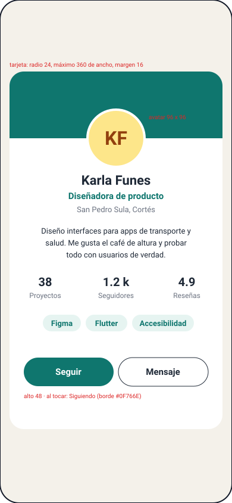

# Tarjeta de perfil

Nivel: inicial

La tarjeta de una diseñadora inventada, Karla Funes, con su avatar, sus cifras, sus habilidades y un botón para seguirla. Es el reto para calentar: `Stack`, `Row`, `Column` y un poquito de estado.

## Qué tiene que tener

1. Fondo de pantalla color crema y, centrada, una tarjeta blanca.
2. Arriba de la tarjeta, una franja de color con el avatar montado a caballo entre la franja y el blanco.
3. Avatar redondo con las iniciales `KF`.
4. Nombre `Karla Funes`, rol `Diseñadora de producto` y ciudad `San Pedro Sula, Cortés` con un ícono de ubicación.
5. Biografía: `Diseño interfaces para apps de transporte y salud. Me gusta el café de altura y probar todo con usuarios de verdad.`
6. Tres cifras en una fila, cada una con su etiqueta debajo: `38` Proyectos, `1.2 k` Seguidores, `4.9` Reseñas.
7. Tres habilidades como pastillas: `Figma`, `Flutter`, `Accesibilidad`.
8. Dos botones del mismo ancho: `Seguir` y `Mensaje`.

## Medidas

| Elemento | Medida |
|---|---|
| Margen de la pantalla | 16 |
| Tarjeta | ancho máximo 360, radio 24, sombra suave (desenfoque 24, baja 8) |
| Franja de arriba | alto 112 |
| Avatar | 96 x 96 con borde blanco de 4 (obligatorio) |
| Pastillas | relleno 12 a los lados y 6 arriba y abajo, radio completo |
| Botones | alto 48 (obligatorio como mínimo), separación 12 |

## Colores

| Uso | Hex |
|---|---|
| Fondo de la pantalla | `#F4F1EA` |
| Tarjeta | `#FFFFFF` |
| Acento (franja, rol, botón Seguir) | `#0F766E` |
| Texto principal | `#1F2937` |
| Texto secundario | `#6B7280` |
| Fondo del avatar | `#FDE68A` |
| Iniciales | `#92400E` |
| Fondo de las pastillas | `#E6F4F1` |

## Tipografía

La del sistema (Roboto en Android).

| Texto | Tamaño | Peso |
|---|---|---|
| Iniciales | 32 | 700 |
| Nombre | 22 | 700 |
| Rol | 15 | 600 |
| Ciudad | 13 | 400 |
| Biografía | 14, interlineado 1.5 | 400 |
| Cifra | 20 | 700 |
| Etiqueta de la cifra | 12 | 400 |

## Estados

1. Al abrir: el botón dice `Seguir`, relleno con el acento y texto blanco.
2. Al tocarlo: dice `Siguiendo`, con fondo blanco y borde y texto del acento.
3. Al tocarlo otra vez regresa a `Seguir`.

## Keys acordadas

| Key | Va en |
|---|---|
| `avatar` | el círculo del avatar (el widget de 96 x 96) |
| `boton-seguir` | el botón Seguir o Siguiendo |

## Lo que revisan las pruebas

1. Los textos de nombre, rol, ciudad y biografía.
2. Que el avatar mida 96 x 96 y tenga `KF` adentro.
3. Las tres cifras con sus etiquetas y las tres habilidades.
4. Que el botón cambie entre `Seguir` y `Siguiendo`.
5. Que el botón mida al menos 48 de alto y que exista `Mensaje`.
6. Que en un teléfono de 360 x 640 nada se desborde. Pista: la tarjeta va dentro de un `SingleChildScrollView`.

## Para ir más allá

1. Que el número de seguidores suba a `1.3 k` cuando la seguís.
2. Una animación suave al cambiar de botón con `AnimatedSwitcher`.
