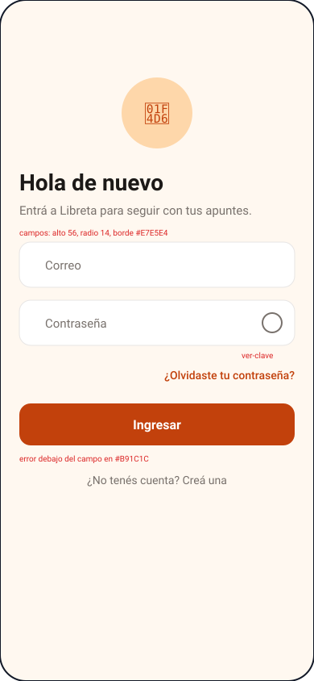

# Inicio de sesión

Nivel: inicial

La pantalla para entrar a Libreta, una app de apuntes inventada. Aquí practicás `Form`, validadores y el truco de mostrar u ocultar la contraseña.

## Qué tiene que tener

1. Arriba, un círculo con un ícono de libro o cuaderno.
2. Título `Hola de nuevo` y debajo `Entrá a Libreta para seguir con tus apuntes.`
3. Campo `Correo` con ícono de sobre.
4. Campo `Contraseña` con ícono de candado y, a la derecha, un botón de ojito para verla.
5. Enlace `¿Olvidaste tu contraseña?` alineado a la derecha.
6. Botón `Ingresar` de todo el ancho.
7. Abajo: `¿No tenés cuenta?` y el enlace `Creá una`.

## Medidas

| Elemento | Medida |
|---|---|
| Margen de la pantalla | 24 a los lados, 32 arriba y abajo |
| Círculo de arriba | 88 x 88, ícono de 44 |
| Campos | alto 56, radio 14, separación 16 (alto mínimo 48 obligatorio) |
| Botón Ingresar | alto 52, radio 14 (alto mínimo 48 obligatorio) |

## Colores

| Uso | Hex |
|---|---|
| Fondo | `#FFF8F0` |
| Primario (botón, enlaces, borde con foco) | `#C2410C` |
| Círculo de arriba | `#FED7AA` |
| Texto principal | `#1C1917` |
| Texto suave | `#78716C` |
| Fondo de los campos | `#FFFFFF` |
| Borde de los campos | `#E7E5E4` |
| Error | `#B91C1C` |

## Tipografía

| Texto | Tamaño | Peso |
|---|---|---|
| Título | 28 | 700 |
| Subtítulo | 15 | 400 |
| Etiquetas de los campos | 15 | 400 |
| Botón | 16 | 600 |

## Estados

1. La contraseña arranca oculta. El ojito la muestra y la vuelve a ocultar.
2. Al tocar `Ingresar` se validan los dos campos:
   1. Correo: tiene que tener algo, una `@`, algo, un punto y algo. Si no, el error dice `Escribí un correo válido`.
   2. Contraseña: al menos 8 caracteres. Si no, el error dice `Usá al menos 8 caracteres`.
3. Si todo está bien, sale un `SnackBar` que dice `Listo, ya entraste`.

## Keys acordadas

| Key | Va en |
|---|---|
| `campo-correo` | el campo del correo (`TextField` o `TextFormField`) |
| `campo-clave` | el campo de la contraseña |
| `ver-clave` | el botón del ojito |
| `boton-ingresar` | el botón Ingresar |

## Lo que revisan las pruebas

1. Título, subtítulo, campos, enlaces y botón.
2. Que la contraseña arranque oculta y el ojito la muestre y la oculte.
3. Con todo vacío salen los dos errores.
4. `karla.correo.hn` no pasa como correo. `cafecit` (7 letras) no pasa como contraseña.
5. Con `karla@libreta.hn` y `cafecito2026` sale `Listo, ya entraste`.
6. Campos y botón de al menos 48 de alto, y nada desbordado en 360 x 640.

## Para ir más allá

1. Un indicador de carga en el botón por un segundo antes del mensaje.
2. Que el teclado pase del correo a la contraseña con el botón de siguiente (`textInputAction`).
