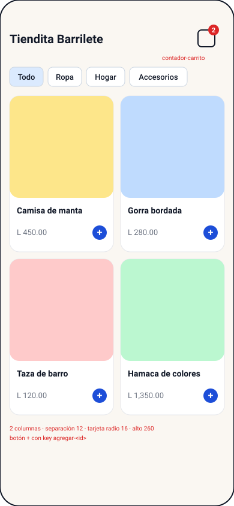

# Catálogo de tienda

Nivel: intermedio

El catálogo de Tiendita Barrilete, una tienda inventada de ropa y cosas para la casa. Una cuadrícula de productos con filtros por categoría y un carrito que va contando.

## Qué tiene que tener

1. Barra de arriba con el título `Tiendita Barrilete` y un ícono de carrito con un contador encima.
2. Una fila de filtros: `Todo`, `Ropa`, `Hogar`, `Accesorios`. Arranca en `Todo`.
3. Cuadrícula de dos columnas con los productos.
4. Cada tarjeta: un bloque de color con un ícono (no hay fotos), el nombre, el precio y un botón para agregar.

## Los productos

Están en [`datos.dart`](datos.dart). Podés importarlo desde tu solución con `import '../../datos.dart';` o copiarlo.

| id | Nombre | Categoría | Precio | Color del bloque |
|---|---|---|---|---|
| `camisa-manta` | Camisa de manta | Ropa | L 450.00 | `#FDE68A` |
| `gorra-bordada` | Gorra bordada | Accesorios | L 280.00 | `#BFDBFE` |
| `taza-barro` | Taza de barro | Hogar | L 120.00 | `#FECACA` |
| `hamaca` | Hamaca de colores | Hogar | L 1,350.00 | `#BBF7D0` |
| `bolso-tule` | Bolso de tule | Accesorios | L 390.00 | `#E9D5FF` |
| `vestido-bordado` | Vestido bordado | Ropa | L 980.00 | `#FBCFE8` |

Los precios se escriben así: `L`, un espacio, miles con coma y dos decimales con punto. Por ejemplo `L 1,350.00`. Armá tu propia función para darles formato.

## Medidas

| Elemento | Medida |
|---|---|
| Fila de filtros | alto 56, separación 8 entre filtros |
| Cuadrícula | margen 16, dos columnas (obligatorio), separación 12 |
| Tarjeta | alto 260, radio 16, borde `#E5E7EB` |
| Bloque de color | ocupa el espacio que sobra arriba de la tarjeta |

## Colores

| Uso | Hex |
|---|---|
| Fondo | `#FAF7F2` |
| Primario (filtro activo, botón agregar) | `#1D4ED8` |
| Tarjeta | `#FFFFFF` |
| Texto principal | `#111827` |
| Precio | `#6B7280` |
| Contador del carrito | `#DC2626` con número blanco |

## Tipografía

| Texto | Tamaño | Peso |
|---|---|---|
| Título | 20 | 700 |
| Nombre del producto | 14 | 600, máximo dos líneas |
| Precio | 13 | 400 |

## Estados

1. El filtro activo se ve distinto. Al tocar otro, la cuadrícula muestra solo esa categoría. `Todo` muestra todo.
2. El contador del carrito no se ve mientras esté en 0. Cada toque en agregar suma 1.

## Keys acordadas

| Key | Va en |
|---|---|
| `contador-carrito` | el widget del contador (por ejemplo un `Badge`); tiene que existir aunque esté en 0 |
| `agregar-<id>` | el botón agregar de cada producto, por ejemplo `agregar-camisa-manta` |

## Lo que revisan las pruebas

1. El título y los cuatro filtros.
2. Que se vean la camisa y la gorra con sus precios.
3. Que sean dos columnas: camisa y gorra en la misma fila, la taza abajo a la izquierda.
4. Que `Hogar` deje solo la taza y la hamaca (con `L 1,350.00`), y que `Accesorios` muestre el bolso.
5. Que el contador marque 1 y después 3 al ir agregando.
6. Nada desbordado en 360 x 640.

## Para ir más allá

1. Una barra de búsqueda que filtre por nombre.
2. En pantallas anchas, tres o cuatro columnas con `SliverGridDelegateWithMaxCrossAxisExtent`.
