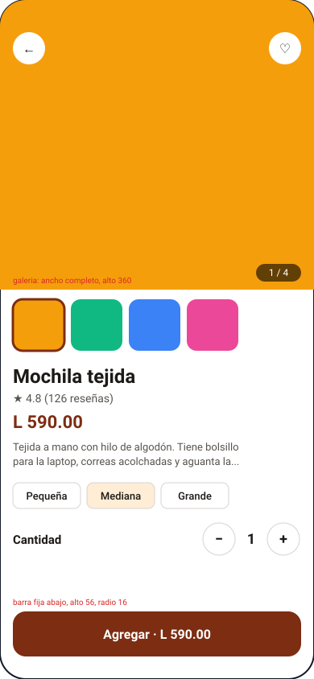

# Detalle con galería

Nivel: intermedio

La pantalla de detalle de una mochila tejida de Tiendita Barrilete. Galería que se desliza, miniaturas, talla, cantidad y un botón que muestra el total.

## Qué tiene que tener

1. Galería arriba con 4 fotos. No hay fotos de verdad: cada una es un bloque de color con un ícono de mochila.
2. Encima de la galería: botón de regresar a la izquierda y corazón de favorito a la derecha.
3. En la esquina de abajo de la galería, un indicador `1 / 4`.
4. Debajo, una fila de 4 miniaturas. La activa lleva borde del color primario.
5. Nombre `Mochila tejida`, valoración `4.8 (126 reseñas)` con una estrella y precio `L 590.00`.
6. Descripción: `Tejida a mano con hilo de algodón. Tiene bolsillo para la laptop, correas acolchadas y aguanta la lluvia de la tarde.`
7. Talla: `Pequeña`, `Mediana`, `Grande`. Arranca en `Mediana`.
8. Fila de cantidad con botón menos, el número y botón más.
9. Barra fija abajo con el botón `Agregar · L 590.00`.

## Medidas

| Elemento | Medida |
|---|---|
| Galería | ancho completo y alto 360 (obligatorio) |
| Botones sobre la galería | 40 x 40, margen 8 |
| Indicador | relleno 10 y 4, radio completo, a 16 de la esquina |
| Miniaturas | 64 x 64, radio 12, separación 8, borde de 3 en la activa |
| Margen del contenido | 16 |
| Botón de abajo | alto 56, radio 16 |

## Colores

| Uso | Hex |
|---|---|
| Fondo | `#FFFFFF` |
| Primario (precio, botón, borde activo) | `#7C2D12` |
| Texto principal | `#1C1917` |
| Texto suave | `#57534E` |
| Estrella | `#F59E0B` |
| Fotos 1 a 4 | `#F59E0B`, `#10B981`, `#3B82F6`, `#EC4899` |
| Fondo del indicador | `#000000` al 60% |

## Tipografía

| Texto | Tamaño | Peso |
|---|---|---|
| Nombre | 24 | 700 |
| Precio | 22 | 700 |
| Descripción | 14, interlineado 1.5 | 400 |
| Cantidad | 18 | 600 |

## Estados

1. Deslizar la galería o tocar una miniatura cambia de foto y actualiza el indicador.
2. La cantidad va de 1 a 10. En 1, el botón menos no baja más.
3. El botón de abajo muestra el total: precio por cantidad, con el mismo formato (`L 1,180.00` con 2).
4. El corazón usa `Icons.favorite_border` y al tocarlo cambia a `Icons.favorite`.

## Keys acordadas

| Key | Va en |
|---|---|
| `galeria` | el `PageView` de las fotos |
| `indicador-foto` | el widget que muestra `1 / 4` |
| `miniatura-0` a `miniatura-3` | cada miniatura |
| `favorito` | el botón del corazón |
| `menos`, `mas` | los botones de cantidad |
| `cantidad` | el texto con el número (o el widget que lo contiene) |
| `boton-agregar` | el botón de abajo |

## Lo que revisan las pruebas

1. Nombre, precio, valoración y descripción.
2. Que la galería mida el ancho de la pantalla por 360 y arranque en `1 / 4`.
3. Que deslizar pase a `2 / 4` y que las miniaturas salten a la foto 4 y regresen a la 1.
4. Las tres tallas.
5. Que la cantidad no baje de 1 y que con 2 el botón diga `L 1,180.00`.
6. Que el corazón cambie de ícono.
7. Nada desbordado en 360 x 640.

## Para ir más allá

1. Puntitos debajo de la galería además del indicador.
2. Un `Hero` desde el catálogo del reto 03 hasta esta pantalla.
