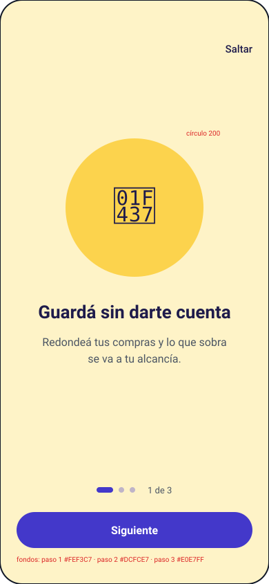

# Bienvenida de tres pasos

Nivel: intermedio

Las pantallas de bienvenida de Alcancía, una app de ahorro inventada. Tres pasos que se pasan deslizando o con un botón, una opción para saltarlos y una pantalla final.

## Los tres pasos

| Paso | Título | Texto | Fondo | Círculo |
|---|---|---|---|---|
| 1 | Guardá sin darte cuenta | Redondeá tus compras y lo que sobra se va a tu alcancía. | `#FEF3C7` | `#FCD34D` |
| 2 | Metas que sí se cumplen | Ponele nombre y fecha a cada meta: la feria, una laptop o el viaje a la playa. | `#DCFCE7` | `#86EFAC` |
| 3 | Mirá cómo crece | Cada semana te mostramos cuánto llevás y cuánto te falta. | `#E0E7FF` | `#A5B4FC` |

Cada paso lleva un ícono que vos elegís dentro del círculo.

## Qué tiene que tener

1. Arriba a la derecha, el botón `Saltar`.
2. En el centro, el paso actual: círculo con ícono, título y texto.
3. Abajo, los puntitos de avance y el texto `1 de 3`.
4. Botón de todo el ancho que dice `Siguiente`.
5. Una pantalla final con `Todo listo` y `Tu alcancía te espera.`

## Medidas

| Elemento | Medida |
|---|---|
| Círculo | 200 x 200, ícono de 96 |
| Margen del contenido | 32 a los lados |
| Puntitos | 8 x 8; el activo es una pastilla de 24 x 8 |
| Botón | alto 52, radio completo, margen 24 |

## Colores

| Uso | Hex |
|---|---|
| Primario (botón, puntito activo) | `#4338CA` |
| Puntitos inactivos | `#4338CA` al 20% |
| Títulos | `#1E1B4B` |
| Textos | `#4B5563` |
| Fondo de cada paso | el de la tabla de arriba |

## Tipografía

| Texto | Tamaño | Peso |
|---|---|---|
| Título del paso | 26 | 700 |
| Texto del paso | 16, interlineado 1.4 | 400 |
| `1 de 3` | 13 | 400 |
| Título final | 28 | 700 |

## Estados

1. `Siguiente` pasa al otro paso. Deslizar también.
2. En el paso 3 el botón dice `Empezar` y el botón `Saltar` desaparece.
3. `Empezar` y `Saltar` llevan a la pantalla final. Ahí ya no hay botón de siguiente.
4. El fondo cambia con el paso. Si lo animás, mejor.

## Keys acordadas

| Key | Va en |
|---|---|
| `paginas` | el `PageView` de los pasos |
| `indicador-paso` | el widget que contiene el texto `1 de 3` (puede contener también los puntitos) |
| `boton-siguiente` | el botón Siguiente o Empezar |
| `boton-saltar` | el botón Saltar |

## Lo que revisan las pruebas

1. Paso 1 con su título, su texto, `1 de 3`, `Siguiente` y `Saltar`.
2. Que `Siguiente` avance a los pasos 2 y 3.
3. Que en el paso 3 diga `Empezar` y no exista `Saltar`.
4. Que `Empezar` y `Saltar` lleven a `Todo listo`.
5. Que deslizar también avance.
6. Nada desbordado en 360 x 640.

## Para ir más allá

1. Recordar con `shared_preferences` que ya viste la bienvenida. Ojo: en este repo no se agregan paquetes, así que eso va en tu propio proyecto.
2. Que el ícono entre con una animación cada vez que cambia el paso.
