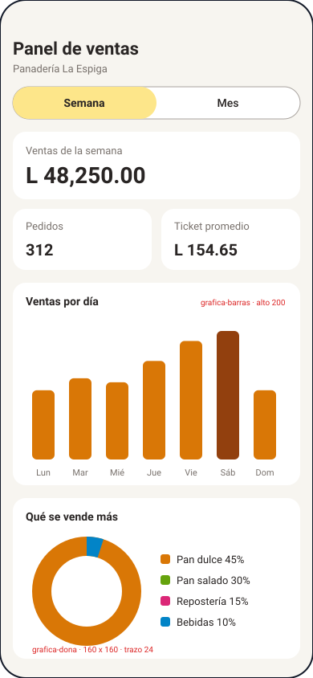

# Panel con gráficas

Nivel: avanzado

El panel de ventas de Panadería La Espiga, un negocio inventado. Cifras arriba y dos gráficas dibujadas a mano con `CustomPaint`: barras por día y una dona por categoría. Sin paquetes de gráficas.

## Qué tiene que tener

1. Barra de arriba con `Panel de ventas` y debajo `Panadería La Espiga`.
2. Selector de periodo con dos opciones: `Semana` y `Mes`. Arranca en `Semana`.
3. Una tarjeta grande con las ventas y dos tarjetas lado a lado: `Pedidos` y `Ticket promedio`.
4. Tarjeta `Ventas por día` con la gráfica de barras. La barra más alta va en un tono más oscuro.
5. Tarjeta `Qué se vende más` con la dona y su leyenda a la derecha.

## Los datos

| | Semana | Mes |
|---|---|---|
| Ventas | `L 48,250.00` | `L 196,400.00` |
| Pedidos | `312` | `1,284` |
| Ticket promedio | `L 154.65` | `L 152.96` |
| Barras | Lun 5200, Mar 6100, Mié 5800, Jue 7400, Vie 8900, Sáb 9650, Dom 5200 | S1 45200, S2 47800, S3 52100, S4 51300 |
| Dona | Pan dulce 45%, Pan salado 30%, Repostería 15%, Bebidas 10% | Pan dulce 42%, Pan salado 33%, Repostería 17%, Bebidas 8% |

Si sumás las barras te da el total de ventas, y el ticket promedio es ventas entre pedidos. Revisalo, es buena práctica.

## Medidas

| Elemento | Medida |
|---|---|
| Margen de la pantalla | 16, separación 12 o 16 entre tarjetas |
| Tarjetas | radio 16, relleno 16 |
| Gráfica de barras | ancho de la tarjeta, alto 200 (mínimo 160 obligatorio) |
| Barras | 60% del ancho de cada columna, esquinas de arriba con radio 6 |
| Dona | 160 x 160 (mínimo 160 de alto obligatorio), trazo de 24 |
| Leyenda | cuadrito de 12 con radio 3 |

## Colores

| Uso | Hex |
|---|---|
| Fondo | `#F7F5F0` |
| Tarjetas | `#FFFFFF` |
| Texto principal | `#292524` |
| Texto suave | `#78716C` |
| Barras | `#D97706`, la más alta `#92400E` |
| Dona: Pan dulce, Pan salado, Repostería, Bebidas | `#D97706`, `#65A30D`, `#DB2777`, `#0284C7` |

## Tipografía

| Texto | Tamaño | Peso |
|---|---|---|
| Título | 22 | 700 |
| Cifra grande | 28 | 700 |
| Cifras chicas | 20 | 700 |
| Etiquetas de las barras | 11 | 400 |
| Leyenda | 13 | 400 |

## Estados

1. `Semana` y `Mes` cambian las cifras, las barras, la dona y la leyenda.
2. Las gráficas se vuelven a pintar al cambiar de periodo. Tu `shouldRepaint` tiene que dar `true` cuando cambian los datos.

## Keys acordadas

| Key | Va en |
|---|---|
| `periodo-semana`, `periodo-mes` | cada opción del selector (puede ir en el texto de la opción) |
| `grafica-barras` | el widget de la gráfica de barras; adentro (o él mismo) tiene un `CustomPaint` con `painter` |
| `grafica-dona` | el widget de la dona; igual, con su `CustomPaint` |

## Lo que revisan las pruebas

1. Título, negocio y las tres cifras de la semana.
2. Que las dos gráficas tengan un `CustomPaint` con su `painter` y midan al menos 160 de alto.
3. La leyenda con las cuatro categorías y sus porcentajes.
4. Que `Mes` cambie a las cifras del mes y que `Semana` las regrese.
5. Que el painter de barras del mes diga `shouldRepaint` true frente al de la semana, y que la leyenda pase a `42%`.
6. Nada desbordado en 360 x 640.

Como las barras se dibujan en el canvas, las pruebas no pueden leer sus etiquetas. Eso se revisa a ojo en el PR.

## Para ir más allá

1. Animar las barras al cambiar de periodo con un `AnimationController`.
2. Tocar una barra y ver su monto en un globito.
