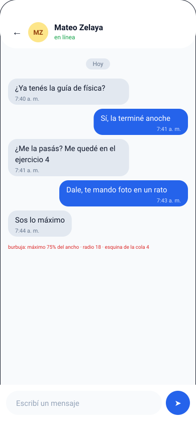

# Chat con burbujas

Nivel: avanzado

Una conversación entre vos y Mateo Zelaya, un compañero inventado que necesita la guía de física. Burbujas a cada lado, horas, separador de día y un campo para mandar mensajes.

## Qué tiene que tener

1. Barra de arriba con botón de regresar, avatar con `MZ`, el nombre `Mateo Zelaya` y debajo `en línea`.
2. Un separador centrado que dice `Hoy`.
3. Los cinco mensajes, cada uno con su hora debajo del texto.
4. Abajo, un campo con el texto de ayuda `Escribí un mensaje` y un botón redondo de enviar.

## Los mensajes

| De | Texto | Hora |
|---|---|---|
| Mateo | ¿Ya tenés la guía de física? | 7:40 a. m. |
| Vos | Sí, la terminé anoche | 7:41 a. m. |
| Mateo | ¿Me la pasás? Me quedé en el ejercicio 4 | 7:41 a. m. |
| Vos | Dale, te mando foto en un rato | 7:43 a. m. |
| Mateo | Sos lo máximo | 7:44 a. m. |

## Medidas

| Elemento | Medida |
|---|---|
| Margen de la lista | 16 |
| Burbuja | ancho máximo 75% de la pantalla (obligatorio), relleno 14 a los lados, radio 18 |
| Cola de la burbuja | la esquina de abajo del lado de quien habla con radio 4 |
| Separación entre burbujas | 8 |
| Avatar | radio 20 |
| Campo | radio 24, relleno 16 y 12 |

## Colores

| Uso | Hex |
|---|---|
| Fondo | `#F8FAFC` |
| Mis burbujas y botón enviar | `#2563EB` con texto blanco |
| Burbujas de Mateo y separador | `#E2E8F0` con texto `#0F172A` |
| Hora | `#64748B` en las de Mateo, blanco al 80% en las mías |
| `en línea` | `#16A34A` |

## Tipografía

| Texto | Tamaño | Peso |
|---|---|---|
| Nombre | 16 | 600 |
| `en línea` | 12 | 400 |
| Mensaje | 15 | 400 |
| Hora | 11 | 400 |

## Estados

1. Mis mensajes van pegados a la derecha. Los de Mateo, a la izquierda.
2. Al enviar, el mensaje aparece al final como mío, con la hora `Ahora`, y el campo queda vacío.
3. Si el campo está vacío o solo tiene espacios, no se envía nada. Lo ideal es que el botón se vea desactivado.

## Keys acordadas

| Key | Va en |
|---|---|
| `campo-mensaje` | el campo de texto |
| `boton-enviar` | el botón de enviar |

## Lo que revisan las pruebas

1. Nombre, `en línea` y `Hoy`.
2. Los cinco mensajes y las horas `7:40 a. m.` y `7:44 a. m.`
3. Que los míos queden de la mitad para la derecha y los de Mateo de la mitad para la izquierda.
4. Que el mensaje más largo no pase del 75% del ancho.
5. Que enviar `Nos vemos en la biblio` lo agregue a la derecha con `Ahora` y limpie el campo.
6. Que un mensaje de puros espacios no se envíe.
7. Nada desbordado en 360 x 640.

## Para ir más allá

1. Que la lista baje sola hasta el último mensaje al enviar.
2. Una burbuja de "escribiendo" con tres puntitos animados.
