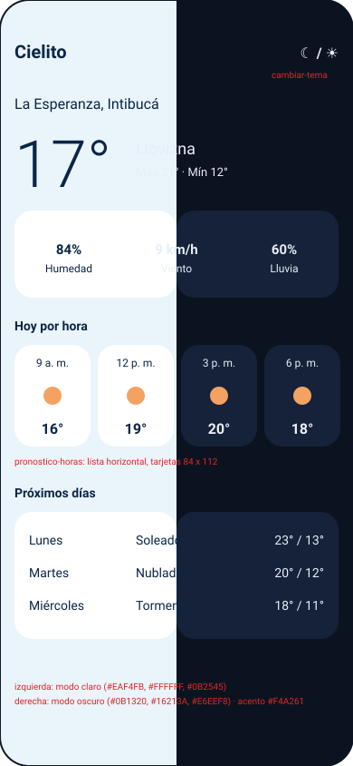

# Clima con modo oscuro

Nivel: avanzado

Cielito, una app de clima inventada con datos de mentira para La Esperanza. Lo importante aquí es el tema: claro y oscuro bien hechos, que arranque como el teléfono y que se pueda cambiar con un botón.

## Qué tiene que tener

1. Barra de arriba con el título `Cielito` y un botón para cambiar de tema.
2. La ciudad `La Esperanza, Intibucá`.
3. La temperatura `17°` en grande, y al lado un ícono, `Llovizna` y `Máx 21° · Mín 12°`.
4. Una tarjeta con tres detalles: `84%` Humedad, `9 km/h` Viento, `60%` Lluvia.
5. `Hoy por hora`: una lista que se desliza de lado con estas horas.

   | Hora | Temperatura |
   |---|---|
   | 9 a. m. | 16° |
   | 12 p. m. | 19° |
   | 3 p. m. | 20° |
   | 6 p. m. | 18° |
   | 9 p. m. | 14° |

6. `Próximos días`: Lunes Soleado 23° / 13°, Martes Nublado 20° / 12°, Miércoles Tormenta 18° / 11°.

## Medidas

| Elemento | Medida |
|---|---|
| Margen de la pantalla | 16 |
| Tarjetas | radio 20, relleno 12 |
| Tarjetas por hora | 84 x 112, separación 8 |
| Temperatura actual | tamaño 72, peso 300 |

## Colores

| Uso | Modo claro | Modo oscuro |
|---|---|---|
| Fondo | `#EAF4FB` | `#0B1320` |
| Tarjetas | `#FFFFFF` | `#16213A` |
| Texto | `#0B2545` | `#E6EEF8` |
| Texto suave | el texto al 70% | el texto al 70% |
| Acento (íconos) | `#F4A261` | `#F4A261` |

Armá dos `ThemeData`, uno claro y uno oscuro, y que los widgets tomen los colores del tema en vez de tenerlos fijos. Ese es el truco del reto.

## Tipografía

| Texto | Tamaño | Peso |
|---|---|---|
| Ciudad | 16 | 400 |
| Temperatura | 72 | 300 |
| Condición | 18 | 400 |
| Hora | 12 | 400 |
| Grados por hora | 16 | 600 |

## Estados

1. Al abrir, sigue el tema del teléfono (`ThemeMode.system`).
2. El botón cambia a oscuro si estás en claro, y a claro si estás en oscuro.
3. Al cambiar, cambian de verdad el fondo de la pantalla y el color de los textos.

## Keys acordadas

| Key | Va en |
|---|---|
| `cambiar-tema` | el botón que cambia el tema |
| `pronostico-horas` | la lista horizontal de horas (o el widget que la contiene) |

## Lo que revisan las pruebas

1. Ciudad, temperatura, condición, máxima, mínima y los tres detalles.
2. Que el pronóstico por hora se deslice hacia la derecha y traiga `9 a. m.` con `16°`.
3. Que con el teléfono en claro abra en claro y con el teléfono en oscuro abra en oscuro.
4. Que el botón pase a oscuro, que cambien el color de fondo del `Scaffold` y el color del texto `17°`, y que otro toque regrese a claro.
5. Nada desbordado en 360 x 640 en modo oscuro.

## Para ir más allá

1. Un fondo con degradado que cambie según la hora.
2. Revisar el contraste de tus colores con una herramienta de WCAG y anotarlo en tu README.
